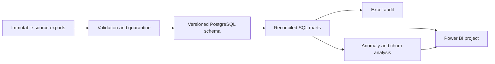
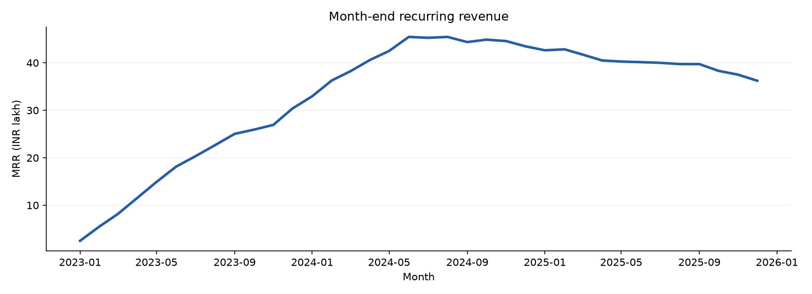
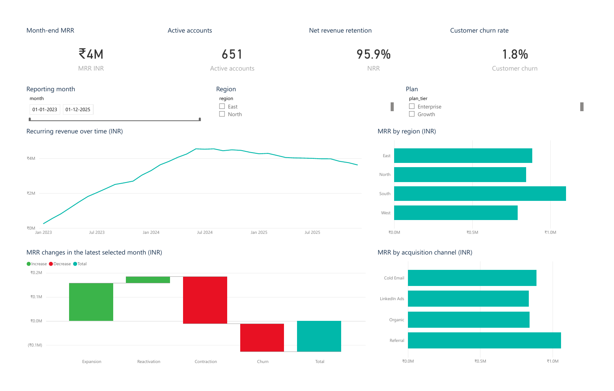

# RevPulse BI

[](https://github.com/AryaShah800/revpulse-saas-analytics/actions/workflows/tests.yml)

Reproducible B2B SaaS revenue, billing quality and retention analytics. **All data is synthetic.** The project separates recurring revenue, invoicing and cash collections, preserves source lineage, and evaluates churn predictions using chronological splits.

**Business question:** where is recurring revenue, billing and retention healthy or leaking in a B2B SaaS business, and what should finance and customer success do about it?

## Data
Synthetic and deterministic: generated by this repo's own code (multi-table accounts, subscriptions, invoices, payments). It is not real revenue; always say "simulated". The simulation adds no new accounts after month 18, so growth analysis is limited.

## Approach
Validate and quarantine bad rows, load versioned PostgreSQL schemas, build reconciled marts (recurring revenue, invoicing, collections), run six SQL analyses, audit in Excel, then train and evaluate a churn model on chronological splits.

## What's included

Implemented and tested: deterministic multi-table generation, strict validation/quarantine, PostgreSQL schemas and financial marts, six SQL analyses, Excel audit workbook, anomaly investigation, trained churn models, score exports, executed notebooks and documentation.

**Status:** the data pipeline, SQL marts, Excel audit workbook, churn models and notebooks are complete and tested. The Power BI report was opened and refreshed in Power BI Desktop and all three pages were checked; `dashboard/RevPulse.pbix`, `RevPulse.pdf` and page images are saved (built locally, **not published** to the Power BI Service). Excel PivotTable refresh has not been checked in desktop Excel. See [delivery report](reports/DELIVERY_REPORT.md).

## Start

```powershell
python -m venv .venv
.\.venv\Scripts\python.exe -m pip install -r requirements-lock.txt
.\.venv\Scripts\python.exe -m pip install -e . --no-deps
.\.venv\Scripts\python.exe scripts/setup_postgres.py
.\.venv\Scripts\python.exe -m revpulse.cli all
.\.venv\Scripts\python.exe -m pytest tests -q
```

See [runbook](docs/runbook.md) for artifact refresh, database configuration, environment reproduction and troubleshooting.

## Review the deliverables

- [Excel audit](excel/RevPulse_Validation_Audit.xlsx): 2025 invoicing and payment-delay audit, XLOOKUP enrichment, two native PivotTables and independent SQL controls.
- [Power BI project](dashboard/RevPulse.pbip), [`RevPulse.pbix`](dashboard/RevPulse.pbix) and [`RevPulse.pdf`](dashboard/RevPulse.pdf) (3 pages): revenue/retention, collection/account actions, and definitions/quality. Page images: [1](dashboard/page-1.png), [2](dashboard/page-2.png), [3](dashboard/page-3.png).
- [Executed EDA notebook](notebooks/01_data_quality_and_eda.ipynb) and [churn evaluation](notebooks/02_churn_evaluation.ipynb).
- [Executive findings](reports/executive_summary.md), [model card](docs/model_card.md), [metric dictionary](docs/metric_dictionary.md), and [cleaning log](docs/DATA_CLEANING_LOG.md).
- [Delivery report](reports/DELIVERY_REPORT.md) lists each requirement with its evidence file and status.

## Architecture



Sources and run outputs are generated under ignored data directories. `data/current.json` identifies the published run and PostgreSQL schema. Core publication is atomic at this pointer. Reference truth never feeds model features. The legacy SQLite prototype is archived and no longer used by the CLI.

## Key findings
See [`reports/executive_summary.md`](reports/executive_summary.md) for the five recommendations. Headline figures:

## Measured results

At 2025-12-31, simulated MRR is ₹3,622,900.00 across 651 active accounts. Selected-model held-out PR-AUC is 0.139; recall is 14.3%. These are measured simulation results, not claims of real-world revenue saved.



## Dashboard
Built and checked in Power BI Desktop (not published to the Power BI Service). The model loads CSV exports with Power Query (M) through a `DataFolder` parameter and defines 13 DAX measures (MRR, active accounts, NRR, churn rate and others).

| Evidence | File |
|---|---|
| Report with data | [`dashboard/RevPulse.pbix`](dashboard/RevPulse.pbix) |
| 3-page export | [`dashboard/RevPulse.pdf`](dashboard/RevPulse.pdf) |
| Page images | `dashboard/page-1.png`, `page-2.png`, `page-3.png` |



Notes for an honest reading:
- Page 3 states that the data is synthetic.
- The collections scatter initially errored (company name in Category with unsummarized X and Y); both axes were set to Average in Desktop and the report was saved, which also rewrote some PBIR/model files.
- The refresh read `C:/Projects/revpulse-saas-analytics/dashboard/data/` (the `DataFolder` value saved in the model), an earlier export (run 20261107T082251_ebe78748). Of its 30 CSVs, 23 are byte-identical to the current rebuild, including the revenue and retention tables behind page 1 (so the 651 accounts and the MRR line match). Seven differ (`churn_predictions`, `heldout_predictions`, `top20_risk`, `dim_plan`, `dim_bridge`, `quality_summary`, `report_metadata`; the last four are not produced by the current rebuild), so risk-page values may differ slightly from a fresh run. Change `DataFolder` (Transform data, Edit parameters) to use another folder.
- After that verified export, the PBIP `DataFolder` was corrected to this checkout (`C:/Projects/Data_Analysis Resume/revpulse-saas-analytics/dashboard/data/`) and current-run helper CSVs were prepared without regenerating the report. The existing PBIX/PDF retain the earlier verified snapshot until the next Desktop refresh/export. That refresh is pending because the computer-use helper disconnected. To prepare helper data alone: `python -c "import runpy; m=runpy.run_path('scripts/build_powerbi.py'); m['prepare_data']()"`. Do not run the full generator over Desktop edits merely to refresh CSVs.
- The month-end MRR card is displayed rounded (it shows ₹4M for ₹3,622,900); the exact figure is in `mart_revenue_month.csv`.

## Limits

Fixed-price INR subscriptions, business-date events, no usage-based pricing, credit-note accounting, tax compliance, real-time ingestion or live customer outreach. Model indicators are associative. See the metric dictionary for churn/retention and plan-segmentation semantics.

## License

MIT. See [LICENSE](LICENSE). All data is synthetic.
