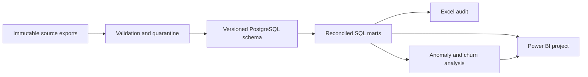

# RevPulse BI

[](https://github.com/AryaShah800/revpulse-saas-analytics/actions/workflows/tests.yml)

Reproducible B2B SaaS revenue, billing quality and retention analytics. **All data is synthetic.** The project separates recurring revenue, invoicing and cash collections, preserves source lineage, and evaluates churn predictions using chronological splits.

## What's included

Implemented and tested: deterministic multi-table generation, strict validation/quarantine, PostgreSQL schemas and financial marts, six SQL analyses, Excel audit workbook, anomaly investigation, trained churn models, score exports, executed notebooks and documentation.

**Status:** the data pipeline, SQL marts, Excel audit workbook, churn models and notebooks are complete and tested. The Power BI project passes schema validation, but it has not yet been opened in Power BI Desktop, so there is no rendered dashboard or `.pbix` export yet. Excel PivotTable refresh has likewise not been checked in desktop Excel. See [delivery report](reports/DELIVERY_REPORT.md).

## Start

```powershell
python -m venv .venv
.\.venv\Scripts\python.exe -m pip install -r requirements-lock.txt
.\.venv\Scripts\python.exe -m pip install -e . --no-deps
.\.venv\Scripts\python.exe scripts/setup_postgres.py
.\.venv\Scripts\python.exe -m revpulse.cli all
.\.venv\Scripts\python.exe -m pytest tests -q
```

See [runbook](docs/runbook.md) for artifact refresh, database configuration, environment reproduction and troubleshooting.

## Review the deliverables

- [Excel audit](excel/RevPulse_Validation_Audit.xlsx): 2025 invoicing and payment-delay audit, XLOOKUP enrichment, two native PivotTables and independent SQL controls.
- [Power BI project](dashboard/RevPulse.pbip): revenue/retention, collection/account actions, and definitions/quality pages.
- [Executed EDA notebook](notebooks/01_data_quality_and_eda.ipynb) and [churn evaluation](notebooks/02_churn_evaluation.ipynb).
- [Executive findings](reports/executive_summary.md), [model card](docs/model_card.md), [metric dictionary](docs/metric_dictionary.md), and [cleaning log](docs/DATA_CLEANING_LOG.md).
- [Delivery report](reports/DELIVERY_REPORT.md) lists each requirement with its evidence file and status.

## Architecture



Sources and run outputs are generated under ignored data directories. `data/current.json` identifies the published run and PostgreSQL schema. Core publication is atomic at this pointer. Reference truth never feeds model features. The legacy SQLite prototype is archived and no longer used by the CLI.

## Measured results

At 2025-12-31, simulated MRR is ₹3,622,900.00 across 651 active accounts. Selected-model held-out PR-AUC is 0.139; recall is 14.3%. These are measured simulation results, not claims of real-world revenue saved.


## Limits

Fixed-price INR subscriptions, business-date events, no usage-based pricing, credit-note accounting, tax compliance, real-time ingestion or live customer outreach. Model indicators are associative. See the metric dictionary for churn/retention and plan-segmentation semantics.

## License

MIT. See [LICENSE](LICENSE). All data is synthetic.
